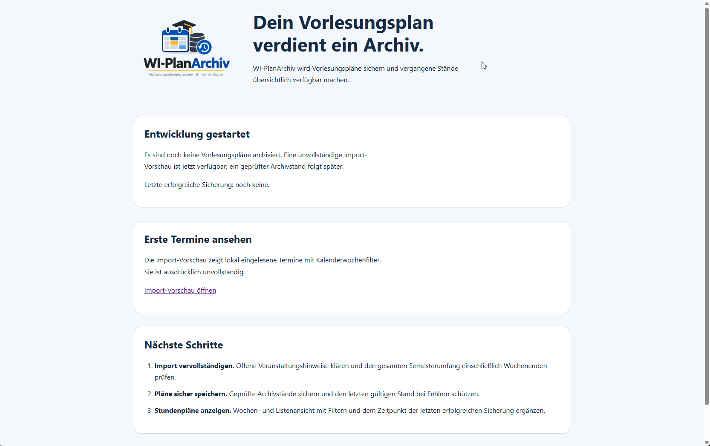
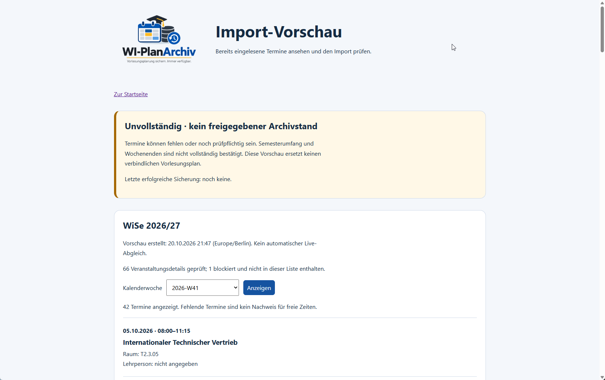

# Die Webseite im Überblick

WI-PlanArchiv zeigt bereits eingelesene Vorlesungstermine in einer **unvollständigen
Import-Vorschau**. Die folgenden Screenshots zeigen die vom Nutzer bereitgestellte
Startseite und die Vorschau mit funktionierendem Kalenderwochenfilter.

Die Aufnahmen dokumentieren einen bestimmten Anzeige- und Datenstand. Trotz der
Dateinamen mit `v0022` zeigt die Vorschau-Aufnahme die bisherige Listenoberfläche,
nicht die in V0.0.22 ergänzte Wochenansicht. Die dargestellten Termine sind keine
fiktiven Beispieldaten; aus den sichtbaren Einträgen lässt sich keine vollständige
Semesterplanung ableiten.

## 1. Startseite: Einstieg und Entwicklungsstand

Die Startseite bietet drei Bereiche:

- **Entwicklung gestartet:** Beschreibt den aktuellen Stand. „Letzte erfolgreiche
  Sicherung: noch keine“ bedeutet, dass noch kein geprüfter Archivstand vorliegt.
  Eine vorhandene Import-Vorschau ist davon unabhängig.
- **Erste Termine ansehen:** Über **„Import-Vorschau öffnen“** gelangt man zur Anzeige
  der lokal eingelesenen Termine.
- **Nächste Schritte:** Nennt die noch geplanten Arbeiten zur vollständigen Erfassung,
  sicheren Archivierung und weiteren Darstellung.

Das Logo steht links neben der Einführung. Die Anwendungsversion befindet sich im
Footer der Webseite; dieser ist in den gezeigten Ausschnitten nicht sichtbar.

## 2. Import-Vorschau: Termine und Kalenderwochenfilter

Die gelbe Hinweiskarte kennzeichnet die Anzeige ausdrücklich als **„Unvollständig ·
kein freigegebener Archivstand“**. Termine können fehlen oder noch geprüft werden
müssen. Die Vorschau ersetzt deshalb keinen verbindlichen Vorlesungsplan.

Unterhalb des Hinweises stehen:

| Angabe | Bedeutung |
| --- | --- |
| Semester | Semester der eingelesenen Vorschau, in der Aufnahme WiSe 2026/27. |
| Vorschau erstellt | Zeitpunkt der Erstellung in Europe/Berlin. Ein Seitenaufruf aktualisiert die Quelldaten nicht. |
| Geprüfte Veranstaltungsdetails | Zahl der untersuchten Veranstaltungen. Blockierte Veranstaltungen sind nicht als Termine enthalten. |
| Kalenderwoche | Begrenzt die Anzeige auf die ausgewählte ISO-Kalenderwoche. `2026-W41` bedeutet Kalenderwoche 41 im ISO-Jahr 2026. |
| Angezeigte Termine | Zahl der einzelnen Termine in der aktuellen Auswahl, nicht die Zahl unterschiedlicher Veranstaltungen. |

In dieser Aufnahme wurden **66 Veranstaltungsdetails** geprüft; **eine Veranstaltung
ist blockiert**. Für die ausgewählte Woche werden **42 Termine** angezeigt. Diese
Zahlen gehören zum abgebildeten Importstand und können bei einem neuen Import abweichen.

### Kalenderwoche wechseln

1. Im Auswahlfeld **„Kalenderwoche“** die gewünschte Woche auswählen.
2. Auf **„Anzeigen“** klicken.
3. Die aktualisierte Liste und die Zahl der angezeigten Termine prüfen.

Jeder Listeneintrag enthält Datum, Uhrzeit, Veranstaltungstitel sowie Angaben zu
Raum und Lehrperson, soweit vorhanden. „Nicht angegeben“ macht fehlende Informationen
sichtbar. Ein fachlicher Prüfhinweis kann zusätzlich am Termin erscheinen.

**Keine Einträge bedeutet nicht automatisch vorlesungsfrei.** Insbesondere die
vollständige Wochenend-Abdeckung ist noch ungeklärt.

## 3. Wochenansicht ab V0.0.22

Nach dem Update auf V0.0.22 steht zusätzlich die Wochenansicht zur Verfügung. Sie ist
in den beiden Aufnahmen noch nicht abgebildet:

- Montag bis Sonntag werden mit Datum und ihren erfassten Terminen angezeigt.
- „Vorherige/Nächste erfasste Woche“ wechselt zwischen Wochen mit Vorschauterminen.
- Über „Listenansicht“ lässt sich zur Terminliste wechseln. Dort ist auch die Auswahl
  aller erfassten Wochen möglich.
- Auf kleineren Bildschirmen werden die Tage in weniger Spalten beziehungsweise
  untereinander dargestellt.

Vorhandene Vorschau-Dateien bleiben kompatibel. Für die neue Ansicht allein ist kein
erneuter Import nötig. Die Warnung vor unvollständigen Daten bleibt in beiden Ansichten erhalten.

## Einrichtung und Aktualisierung

Die Vorschau liest ausschließlich eine lokale Datei. Neue Daten werden durch einen
manuellen Import bereitgestellt, nicht durch das Öffnen oder Neuladen der Webseite.
Der Nutzer hat die Anzeige von Ergebnissen und die Begrenzung per Kalenderwochenfilter
im Serverbetrieb bestätigt.

- [Vorschau einrichten und Termine importieren](preview.md)
- [Installation und Update durchführen](install.md)
- [Geplante Entwicklungsschritte](roadmap.md)
- [Änderungen je Version](timeline.md)

[Zurück zur README](../README.md)
